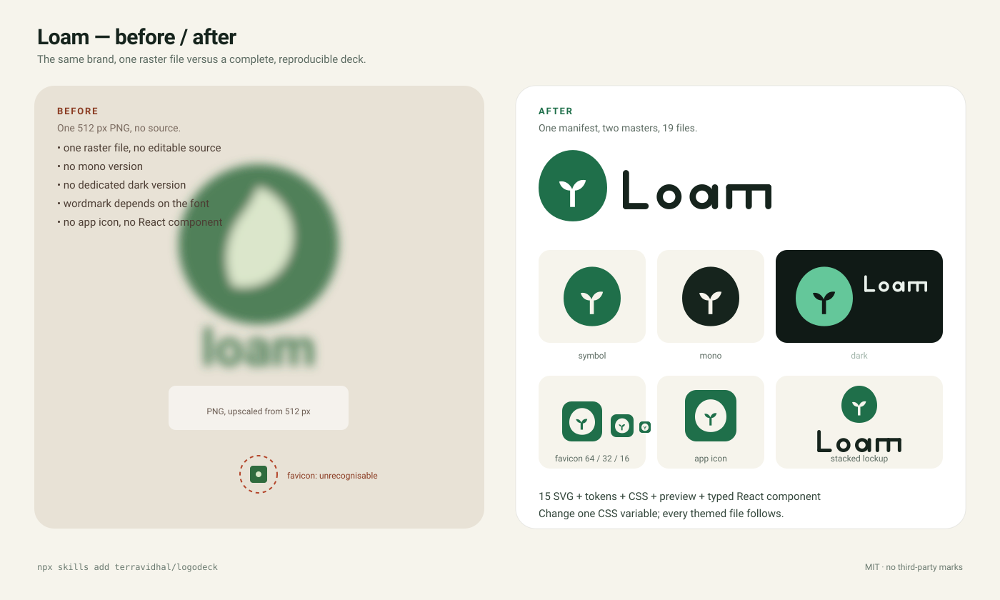

# logodeck

**Draw one original logo, get the whole identity deck.** A symbol, a mono mark, a dark version,
a wordmark, both lockups, a favicon, an app icon, a maskable icon, tokens, CSS, a preview and a
typed React component — from one manifest and two masters.

```bash
npx skills add terravidhal/logodeck
```

Then ask your agent: *“Design a logo for Loam, a soil-health app for small farms. All variants
and the React component.”* The skill writes the brief, rejects the category clichés, draws the
masters as SVG paths, tests them small and in one colour, and builds the deck.



## Why this exists

Most logo skills stop at a single SVG, a concept sheet or a very large reference library.
Logodeck is built around three gaps that remain after the drawing:

### 1. Every variant, in one run

The symbol and the wordmark are the only drawings. The build composes the rest, so the favicon
cannot drift from the header and the dark lockup cannot forget the wordmark.

`<slug>-symbol.svg` · `-symbol-mono` · `-symbol-dark` · `-wordmark` · `-wordmark-mono` ·
`-wordmark-dark` · `-lockup-horizontal` · `-lockup-horizontal-mono` · `-lockup-horizontal-dark` ·
`-lockup-stacked` · `-lockup-stacked-mono` · `-lockup-stacked-dark` · `-favicon` ·
`-app-icon` · `-app-icon-maskable` · `.tsx` · `-tokens.json` · `-palette.css` · `-preview.html`

### 2. Colour in one line

Seven palettes are shipped, all audited. Every pair is measured in both modes; a palette below
the floor is rejected by the build.

```html
<svg class="logo" style="--ld-brand:#0F6B5C; --ld-accent:#FF6B4A">…</svg>
```

```tsx
<LoamLogo type="horizontal" style={{ "--ld-brand": "#0F6B5C" }} />
```

```css
:root { --ld-brand: #0F6B5C; --ld-accent: #FF6B4A; }
```

### 3. React that is ready

The generated component uses the same surface as the Logoforge family — `variant`, `type`,
`mode`, `title` — without Tailwind or an extra package. `mode="auto"` follows `.dark`,
`[data-theme]` and `prefers-color-scheme`; the server snapshot is light.

```tsx
<LoamLogo />                                  // horizontal, colour, auto light/dark
<LoamLogo type="icon" variant="mono" />       // one colour, currentColor
<LoamLogo type="stacked" mode="dark" title="Loam" />
```

## Install

```bash
npx skills add terravidhal/logodeck
```

The skill is plain Markdown plus Node scripts. It also works with a manual copy: put
`skills/logodeck/` wherever your agent looks for skills. No runtime dependency.

## Run it locally

```bash
# the example that ships in this repository
npm run build:example
npm run audit:example
npm run lint

# another palette, or one changed token
node skills/logodeck/scripts/build.mjs examples/loam/logo.json --palette cobalt-mint
node skills/logodeck/scripts/build.mjs examples/loam/logo.json --theme brand=#0F6B5C

# optional raster exports (needs playwright + chromium)
node skills/logodeck/scripts/build.mjs examples/loam/logo.json --png 16,32,192,512 --ico

# optional README captures
npm install --no-save playwright
npx playwright install chromium
npm run capture
```

The SVG build, the audit and the palette check run on Node 20+ with the standard library only.
The browser is for looking and for PNG captures; it is never used to generate the logo.

## The example

**Loam** is a fictional soil-health app for small farms. Its symbol is a seed whose sprout is
cut out of the solid form; its wordmark is a soft geometric lowercase set drawn as paths. The
palette is `moss-clay`.


Everything in `examples/loam` is original and fictional. No third-party logo is used, traced
or embedded.

## The manifest

```json
{
  "name": "Loam",
  "slug": "loam",
  "component": "LoamLogo",
  "title": "Loam — soil health for small farms",
  "palette": "moss-clay",
  "files": {
    "symbol": "symbol.svg",
    "wordmark": "wordmark.svg",
    "symbolSmall": "symbol-small.svg"
  },
  "geometry": {
    "symbolHeight": 1,
    "wordmarkHeight": 0.44,
    "gap": 0.3,
    "padding": 0.08,
    "stackedGap": 0.22,
    "appIconScale": 0.62,
    "appIconRadius": 0.225
  },
  "out": "dist"
}
```

`symbolSmall` is optional: a simplified drawing with thicker negative space for the favicon.
The geometry values are ratios; the build turns them into composed `viewBox` values.

## What is checked

- **Contrast**: brand ≥ 3:1, accent ≥ 3:1, ink ≥ 4.5:1, in light and dark.
- **Structure**: `viewBox`, tight crop, no `<text>`, `<image>`, `<filter>`, no stroke, no raster.
- **Matrix**: all 15 SVG variants, tokens, CSS, preview and TSX are present.
- **React**: only `react`, no `dangerouslySetInnerHTML`, no Tailwind, the four props exist.
- **Reproducibility**: the committed example deck is rebuilt in a temporary directory and
  compared; a stale file fails the check.
- **Secrets**: the check refuses keys, tokens and `.env` files.
- **Size**: the skill stays under 320 KB; the repository stays light.

The audit cannot tell you whether the idea is good or whether the mark reads at 16 px. That is
what the human tests in `skills/logodeck/references/testing.md` are for.

## What it will not do

- Copy, trace or imitate an existing brand. A request to “make it like X” gets an original
  direction and a note about the risk.
- Embed a real logo, a trademark, a font file or a screenshot of someone else's mark.
- Generate a logo with an image model. The output is constructed SVG.
- Clear a trademark, reserve a name, check a domain or invent a Pantone number.
- Publish, push or deploy anything. Delivery is local unless you ask for a specific action.

## Repository layout

```text
skills/logodeck/          the installed skill: SKILL.md, references, assets, scripts
examples/loam/            a complete fictional brand and its generated deck
examples/site/            a static demo page
assets/readme/            proof plates used above
assets/templates/         starter manifest and masters
scripts/check-skill.mjs   repository check (lint)
evals/evals.json          behaviour cases
.github/workflows/       lint, typecheck, build, audit and optional captures
ETUDE.md                  the design study behind the skill
```

## Licence

MIT. No trademark is claimed by this repository. The Loam example is fictional. If you use the
skill for a real brand, run your own trademark and font-licence checks before launching.
