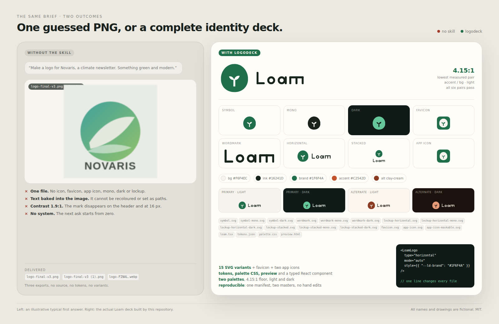
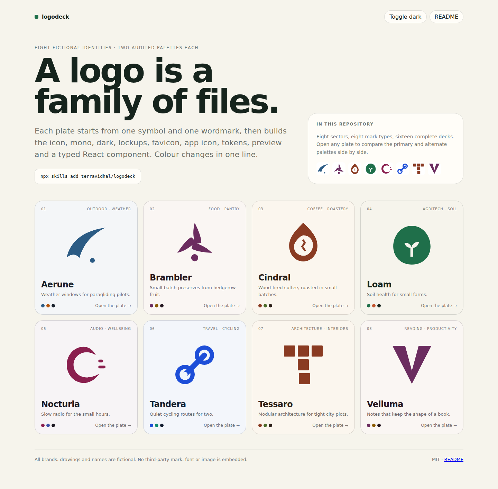
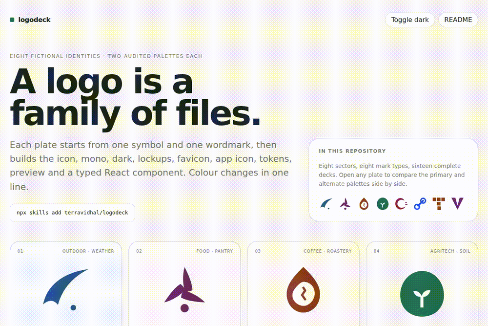
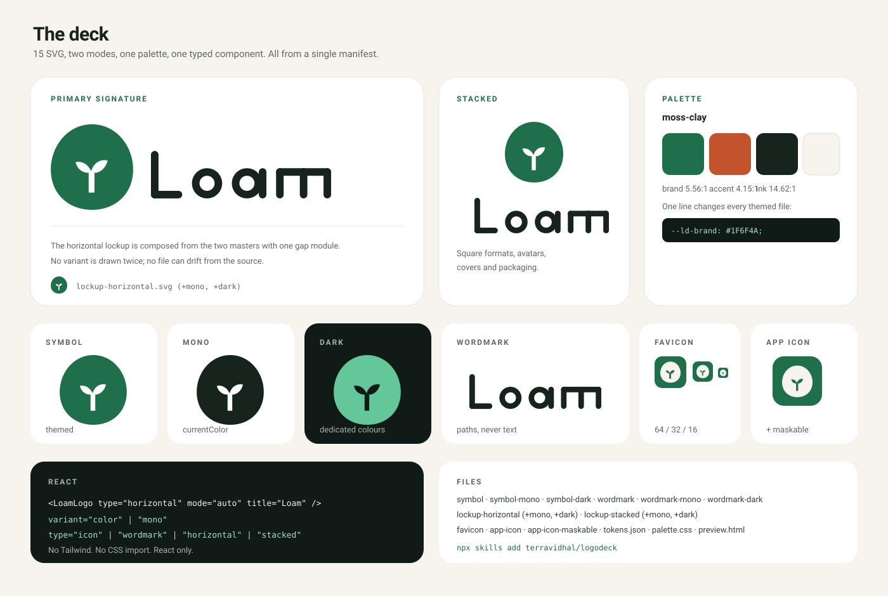

# logodeck

**Draw one original logo, get the whole identity deck.** A symbol, a mono mark, a dark version,
a wordmark, both lockups, a favicon, an app icon, a maskable icon, tokens, CSS, a preview and a
typed React component — from one manifest and two masters. Eight fictional brands ship with the
skill, each in two audited palettes.

```bash
npx skills add terravidhal/logodeck
```

Then ask your agent: *“Design a logo for Loam, a soil-health app for small farms. All variants
and the React component.”* The skill writes the brief, rejects the category clichés, draws the
masters as SVG paths, tests them small and in one colour, and builds the deck.



## What it does

One run takes the name and the promise through seven steps:

1. **Brief.** Name, promise, audience, constraints, and the assumptions the agent must not hide.
2. **Category, then clichés.** What buyers expect, what everyone draws, and the specific angle
   the category does not own.
3. **Directions.** Eight to twelve shape ideas, reduced to three genuinely different marks, one
   choice with a reason.
4. **Two masters.** A symbol and a wordmark, drawn as filled SVG paths, black first.
5. **Tests.** 16 px, one colour, inverted, mirrored, blurred, letter, junction, peer. Two passes.
6. **Deck.** One manifest composes every variant, the tokens, the CSS, the preview and the React
   component; the audit blocks a broken or low-contrast result.
7. **Handover.** What exists, which palette was measured, which tests ran, and what remains a
   limit: trademark, font licence, print proof.

## What makes it different

Most logo skills stop at a single SVG, a concept sheet or a very large reference library.
Logodeck closes the three gaps that remain after the drawing:

### 1. Every variant, in one run

The symbol and the wordmark are the only drawings. The build composes the rest, so the favicon
cannot drift from the header and the dark lockup cannot forget the wordmark.

`<slug>-symbol.svg` · `-symbol-mono` · `-symbol-dark` · `-wordmark` · `-wordmark-mono` ·
`-wordmark-dark` · `-lockup-horizontal` · `-lockup-horizontal-mono` · `-lockup-horizontal-dark` ·
`-lockup-stacked` · `-lockup-stacked-mono` · `-lockup-stacked-dark` · `-favicon` ·
`-app-icon` · `-app-icon-maskable` · `.tsx` · `-tokens.json` · `-palette.css` · `-preview.html`

### 2. Colour in one line

Seven palettes are shipped, all audited. Every pair is measured in both modes; a palette below
the floor is rejected by the build. The examples use two palettes each, from the same drawing.

```html
<svg class="logo" style="--ld-brand:#0F6B5C; --ld-accent:#FF6B4A">…</svg>
```

```tsx
<LoamLogo type="horizontal" style={{ "--ld-brand": "#0F6B5C" }} />
```

```css
:root { --ld-brand: #0F6B5C; --ld-accent: #FF6B4A; }
```

### 3. React that is ready

The generated component uses the same surface as the Logoforge family — `variant`, `type`,
`mode`, `title` — without Tailwind or an extra package. `mode="auto"` follows `.dark`,
`[data-theme]` and `prefers-color-scheme`; the server snapshot is light.

```tsx
<LoamLogo />                                  // horizontal, colour, auto light/dark
<LoamLogo type="icon" variant="mono" />       // one colour, currentColor
<LoamLogo type="stacked" mode="dark" title="Loam" />
```

## The eight examples

Every brand is fictional, every drawing is original, and each folder contains two complete decks
(primary and alternate palette), the masters, and a presentation plate.

| Brand | Sector | Mark | Primary | Alternate |
|---|---|---|---|---|
| [Loam](examples/loam/board.html) | soil health | seed with a sprout cut-out | `moss-clay` | `clay-cream` |
| [Aerune](examples/aerune/board.html) | paragliding weather | wind-cut canopy and pilot dot | `slate-sky` | `midnight-rose` |
| [Brambler](examples/brambler/board.html) | preserves | three thorn blades around a seed | `plum-gold` | `moss-clay` |
| [Tessaro](examples/tessaro/board.html) | architecture | T assembled from tiles | `clay-cream` | `cobalt-mint` |
| [Nocturla](examples/nocturla/board.html) | slow radio | crescent and two-bar signal | `midnight-rose` | `slate-sky` |
| [Velluma](examples/velluma/board.html) | reading notes | two page-arms folded into a V | `plum-gold` | `clay-cream` |
| [Cindral](examples/cindral/board.html) | coffee roastery | bean-shaped crease in a flame | `clay-cream` | `spruce-coral` |
| [Tandera](examples/tandera/board.html) | cycling routes | two wheels and one frame | `cobalt-mint` | `spruce-coral` |



Each plate shows the family, both palettes, the measured contrast and the file list:
[open the gallery](examples/site/index.html). The short tour below is generated from the same
pages with Chromium and ffmpeg.



## Install with your agent

```bash
npx skills add terravidhal/logodeck
```

The CLI detects the coding agents on your machine. To target one, pass its flag:

| Agent | Install |
|---|---|
| Claude Code | `npx skills add terravidhal/logodeck --agent claude-code` |
| Codex | `npx skills add terravidhal/logodeck --agent codex` |
| Cursor | `npx skills add terravidhal/logodeck --agent cursor` |
| Gemini CLI | `npx skills add terravidhal/logodeck --agent gemini` |
| GitHub Copilot | `npx skills add terravidhal/logodeck --agent copilot` |
| OpenCode | `npx skills add terravidhal/logodeck --agent opencode` |

Add `--global` to install once for every project. The skill is plain Markdown plus Node scripts;
a manual copy works too: put `skills/logodeck/` in the folder your agent scans for skills
(`~/.claude/skills/`, `~/.codex/skills/`, `~/.cursor/skills/`, or the equivalent). No runtime
dependency, no build step to install.

## Run it locally

```bash
# all eight examples, two palettes each, then audit the result
npm run build:examples

# the committed decks, boards and proof pages are reproducible
npm run boards
npm run proof

# the example that started it all
npm run build:example
npm run audit:example

# another palette, or one changed token
node skills/logodeck/scripts/build.mjs examples/loam/logo.json --palette cobalt-mint
node skills/logodeck/scripts/build.mjs examples/loam/logo.json --theme brand=#0F6B5C

# optional raster exports (needs playwright + chromium)
node skills/logodeck/scripts/build.mjs examples/loam/logo.json --png 16,32,192,512 --ico

# README captures and the demo GIF
npm run capture
```

The SVG build, the audit and the palette check run on Node 20+ with the standard library only.
The capture script drives Chromium directly over the DevTools protocol, so no npm package is
needed; it finds `CHROME_BIN`, a Playwright Chromium cache or a system Chrome, and needs Node 22+
for the built-in WebSocket client. The GIF uses the system `ffmpeg` when present. The browser is
for looking and for PNG captures; it is never used to generate the logo.

## The example

**Loam** is a fictional soil-health app for small farms. Its symbol is a seed whose sprout is
cut out of the solid form; its wordmark is a soft geometric lowercase set drawn as paths. The
primary palette is `moss-clay`; the alternate is `clay-cream`.



Everything in `examples/` is original and fictional. No third-party logo is used, traced or
embedded, and no font file is shipped: the wordmarks are paths.

## The manifest

```json
{
  "name": "Loam",
  "slug": "loam",
  "component": "LoamLogo",
  "title": "Loam — soil health for small farms",
  "palette": "moss-clay",
  "altPalette": "clay-cream",
  "files": {
    "symbol": "symbol.svg",
    "wordmark": "wordmark.svg",
    "symbolSmall": "symbol-small.svg"
  },
  "geometry": {
    "symbolHeight": 1,
    "wordmarkHeight": 0.44,
    "gap": 0.3,
    "padding": 0.08,
    "stackedGap": 0.22,
    "appIconScale": 0.62,
    "appIconRadius": 0.225,
    "faviconScale": 0.68,
    "maskableScale": 0.5
  },
  "out": "dist",
  "altOut": "dist-alt"
}
```

`symbolSmall` is optional: a simplified drawing with thicker negative space for the favicon.
`altPalette` is optional: when present, `examples/build-examples.mjs` builds `altOut` with the
second palette. The geometry values are ratios; the build turns them into composed `viewBox`
values.

## What is checked

- **Contrast**: brand ≥ 3:1, accent ≥ 3:1, ink ≥ 4.5:1, in light and dark, for every palette.
- **Structure**: `viewBox`, tight crop, no `<text>`, `<image>`, `<filter>`, no stroke, no raster.
- **Matrix**: all 15 SVG variants, tokens, CSS, preview and TSX are present, in both decks.
- **React**: only `react`, no `dangerouslySetInnerHTML`, no Tailwind, the four props exist.
- **Reproducibility**: each committed example deck is rebuilt in a temporary directory and
  compared; a stale file fails the check.
- **Boards and proof**: the eight plates, the gallery and the before/after page are regenerated
  from the committed decks and compared in CI.
- **Secrets**: the check refuses keys, tokens and `.env` files.
- **Size**: the skill stays under 320 KB; the proof captures are the only heavy files.

The audit cannot tell you whether the idea is good or whether the mark reads at 16 px. That is
what the human tests in `skills/logodeck/references/testing.md` are for.

## What it will not do

- Copy, trace or imitate an existing brand. A request to “make it like X” gets an original
  direction and a note about the risk.
- Embed a real logo, a trademark, a font file or a screenshot of someone else's mark.
- Generate a logo with an image model. The output is constructed SVG.
- Clear a trademark, reserve a name, check a domain or invent a Pantone number.
- Publish, push or deploy anything. Delivery is local unless you ask for a specific action.

## FAQ

**Does it need an API key, a model or an account?** No. The logo is constructed SVG drawn by the
agent; the scripts run on Node 20+ with the standard library. A browser is only needed to look at
the preview and capture PNGs.

**Can I change the colours after delivery?** Yes. Change one token, or rebuild with another
palette, and every themed variant follows. Mono and fixed dark files stay valid.

**Is the React component usable as-is?** Yes. It needs only `react`, exposes `variant`, `type`,
`mode` and `title`, and follows `.dark`, `[data-theme]` and the system preference.

**Can I use the result for a real brand?** Yes, but the skill cannot clear a trademark, reserve a
name, check a domain or license a typeface. Do those checks before launch.

**Will it reproduce an existing logo?** No. A request to imitate becomes an original direction
with a note about the trademark risk.

**What if I only need a favicon or a dark version?** Use the assets mode. It builds the missing
variants from the art you supply without redrawing the identity.

## Repository layout

```text
skills/logodeck/          the installed skill: SKILL.md, references, assets, scripts
examples/<brand>/         masters, two decks (dist, dist-alt), board.html
examples/site/            the gallery and the before/after plate
examples/make-masters.mjs the drawing generator for the seven added brands
examples/typecheck/       tsconfig for the generated React components
assets/readme/            captures at 1440 / 390, light and dark, plus before/after
assets/demo.gif           the short tour
assets/templates/         starter manifest and masters
scripts/check-skill.mjs   repository check (lint)
evals/evals.json          behaviour cases
.github/workflows/        lint, typecheck, builds, audits and optional captures
ETUDE.md                  the design study behind the skill
```

## Licence

MIT. No trademark is claimed by this repository. Every example is fictional. If you use the
skill for a real brand, run your own trademark and font-licence checks before launching.
